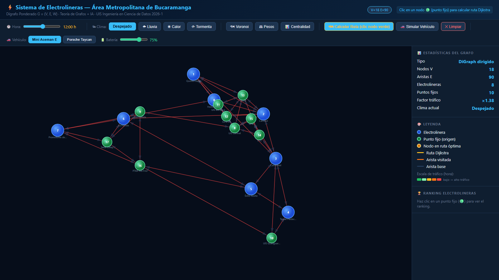

# Sistema de electrolineras para vehículos eléctricos — Bucaramanga

> **EN:** Python system that models the Bucaramanga metro road network as a weighted digraph (18 nodes, 90 edges) with traffic, weather and incidents, finds the nearest EV charging station with Dijkstra, compares it with Floyd-Warshall and trains Random Forest models on up to 100,000 simulated trips. Includes an interactive D3.js visualizer.

**Demo en vivo del visualizador:** https://camibleid.github.io/Proyecto-Electrolineras-Bucaramanga-2026-Camilo_Amaya/



## Problema

Un vehículo eléctrico con la batería en zona crítica (10–20 %) necesita llegar a la electrolinera más cercana, y "más cercana" cambia según la hora, el clima y los incidentes en la vía. El proyecto modela esa situación en el área metropolitana de Bucaramanga para responder dos preguntas: ¿a qué estación conviene ir en cada momento? y ¿qué estaciones soportan más demanda?

## Cómo funciona

- **Grafo:** dígrafo ponderado `G = (V, E, W)` con NetworkX: 18 nodos (8 electrolineras y 10 puntos de referencia como UIS, UNAB, UTS y UPB) y 90 aristas dirigidas con distancias en km.
- **Pesos dinámicos:** distancia base × factor de tráfico por hora × factor de clima (despejado, lluvia, calor, tormenta) × incidentes aleatorios (accidente, obra, vía inundada…).
- **Vehículos:** Mini Aceman E (38,5 kWh) y Porsche Taycan Plus (97 kWh), con consumo ajustado por clima. Datos de ev-database.org.
- **Rutas:** Dijkstra para la electrolinera más cercana y benchmark Dijkstra vs Floyd-Warshall.
- **Análisis de red:** centralidad de intermediación (betweenness) y de cercanía (closeness).
- **Machine learning:** Random Forest clasificador (qué electrolinera usará el vehículo) y regresor (a qué distancia), con 15 variables y división 80/20.
- **Datos:** cada simulación se exporta a CSV y JSON para reentrenar el modelo con más registros.
- **Visualizador web (D3.js v7.9):** Dijkstra animado, control de hora y clima, zonas de cobertura (Voronoi), modo centralidad y simulación de batería por vehículo.

## Resultados

Medidos con los CSV exportados por el programa (opción `5b`, `random_state=42`, reproducibles):

| Datos de entrenamiento | Recargas | Accuracy clasificador | MAE regresor |
|---|---|---|---|
| 6.100 recorridos simulados | 1.346 | 37,0 % | 2,14 km |
| 100.000 recorridos simulados | 22.998 | 44,8 % | 2,07 km |

- Línea base: con 8 clases el azar da 12,5 % y predecir siempre la estación más usada da ~24 %. El modelo las supera, pero no reemplaza a Dijkstra: sirve como estimación rápida.
- Estaciones más usadas (6.100 recorridos): Homecenter 324 recargas (24,1 %), CC Cacique 239, CC La Florida 234.
- Distancia promedio hasta la electrolinera: 5,34 km.
- Benchmark (todos los pares, 18 nodos): Dijkstra 0,87 ms frente a Floyd-Warshall 1,65 ms.

## Cómo ejecutarlo

Requiere Python 3.9 o superior.

```bash
pip install -r requirements.txt
python ProyectoFinal_Electrolineras_2026.py
```

El programa abre un menú por consola. Empieza por la opción `1` (configurar el grafo), luego `3` (simular recorridos), `5` (entrenar el modelo) y `8 → c` (abrir el visualizador). El visualizador también funciona solo: abre `visualizador_electrolineras.html` en el navegador.

## Estructura

| Archivo | Contenido |
|---|---|
| `ProyectoFinal_Electrolineras_2026.py` | Programa principal (menú, grafo, Dijkstra, simulación, ML) |
| `ProyectoFinal_Electrolineras_2026 Con Notaciones Explicado.py` | La misma lógica con explicaciones paso a paso |
| `visualizador_electrolineras.html` | Visualizador interactivo en D3.js |
| `Presentación … .pptx` | Presentación de la sustentación |
| `requirements.txt` | Dependencias |

## Limitaciones

- El grafo es sintético: las aristas y distancias se definieron a mano, no se extrajeron de OpenStreetMap.
- Los recorridos son simulados, no datos reales de vehículos.
- La estación elegida depende de incidentes aleatorios, lo que limita la accuracy del clasificador.

## Equipo

Proyecto integrador 2026-1 de Algoritmos y Programación y Matemáticas Discretas, Universidad Industrial de Santander.

- Camilo Amaya Mora
- Johen Castañeda García
- Hector Felipe Higuera Jurado
